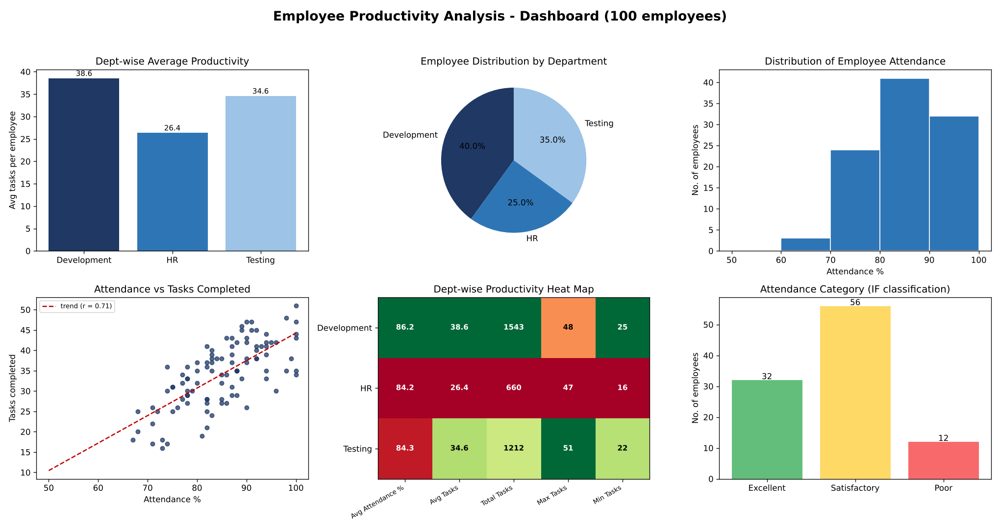

# Case Study 3 – Employee Attendance and Productivity Analysis

**Submitted by:** Jefflin Keona J | **Roll No:** 26AD1121
**Course:** B.Tech Artificial Intelligence and Data Science, St. Joseph's College of Engineering

---

## 1. Case Study Title
Employee Attendance and Productivity Analysis for an IT Company using Spreadsheets

## 2. Problem Statement
An IT company maintains employee attendance and monthly productivity records. The HR department wants to:
- identify employees with poor attendance,
- compare department-wise productivity, and
- analyze the relationship between attendance and productivity.

## 3. Objectives
1. Organise the employee data in a well-formatted workbook with data validation.
2. Use spreadsheet functions to compute key statistics (average, total, max, min, count).
3. Classify employees by attendance using the `IF()` function.
4. Sort, filter, group and conditionally format the data to find poor-attendance employees.
5. Build a department-wise productivity summary.
6. Visualise the data with a bar chart, pie chart, histogram, scatter plot and heat map.
7. Interpret the results and suggest ways to improve productivity.

## 4. Dataset Description
**100 employees** across 3 departments (Development, Testing, HR). File: `Employee_Data.csv`

- Records **E101–E112** are the sample dataset given in the case study.
- Records **E113–E200** are **simulated** (random generation with a fixed seed) to extend the sample to 100 employees so that the charts and statistics are more meaningful.

| Column | Description |
|---|---|
| Employee ID | Unique ID (E101 – E200) |
| Name | Employee name |
| Department | Development / Testing / HR |
| Attendance % | Monthly attendance percentage |
| Tasks Completed | Number of tasks completed in the month |

**Assumption:** productivity is measured by *Tasks Completed*.

## 5. Spreadsheet Functions Used
| Function | Purpose |
|---|---|
| `AVERAGE()` | Average attendance |
| `SUM()` | Total tasks completed |
| `MAX()` / `MIN()` | Highest and lowest tasks completed |
| `COUNT()` / `COUNTA()` | Number of employees |
| `IF()` (nested) | Attendance category: ≥90 Excellent, 75–89 Satisfactory, <75 Poor |
| `COUNTIF()` / `COUNTIFS()` | Category counts, department counts, histogram bins |
| `SUMIF()` / `AVERAGEIF()` | Department-wise totals and averages |
| `MAXIFS()` / `MINIFS()` | Department-wise max and min tasks |
| `RANK()` | Department rank and tie-safe employee ranking |
| `INDEX()` + `MATCH()` | Sorted (descending) task list and poor-attendance filter list |
| `IFERROR()` | Leaves spare rows blank in the filter list |
| `CORREL()` | Correlation between attendance and tasks |

Workbook: `Employee_Productivity_Analysis.xlsx` (sheets: Data, Formulas, Summary, Analysis, Heat Map, Charts, Interpretation)

## 6. Data Analysis Techniques Performed
- **Sorting** all 100 employees by tasks completed (descending).
- **Filtering** employees with attendance below 75% (AutoFilter and a formula-based list).
- **Grouping** employees department-wise.
- **Conditional formatting** to highlight attendance below 75% (red rows).
- **Data validation** – drop-down for department names; attendance restricted to 0–100.
- **Department-wise summary** – count, average attendance, total / average / max / min tasks, rank.
- **Correlation analysis** between attendance and tasks completed.

## 7. Charts and Visualizations Created
| Chart | Purpose |
|---|---|
| Bar chart | Department-wise average productivity |
| Pie chart | Employee distribution by department |
| Histogram | Distribution of attendance |
| Scatter plot (with trendline) | Attendance vs tasks completed |
| Heat map | Department-wise productivity metrics |

See `Screenshots/Dashboard.png` and the individual images in `Screenshots/`.



## 8. Important Observations
- **Development** has the highest average productivity (38.6 tasks per employee); **HR** has the lowest (26.4).
- **Mythili (E197)** completed the most tasks (51); **Catherine (E151)** the fewest (16).
- Overall average attendance is **85.0%**; total tasks completed is **3415**.
- **12 employees** (12%) have poor attendance (<75%); 32 are Excellent and 56 Satisfactory.
- Attendance and tasks have a strong positive correlation (**r ≈ 0.71**), but it is not perfect (e.g. Karthik: 90% attendance, only 26 tasks).

Full details: [Observations_and_Conclusion.md](Observations_and_Conclusion.md)

## 9. Conclusion
Development is the most productive department and HR the least. Employees with poor attendance average 22.5 tasks compared with 35.7 for the rest, so attendance and output clearly go together. The relationship is not perfect, so HR should track attendance together with task output and support low performers through mentoring and flexible policies.

## 10. Google Sheets Sharing Link
> **Paste your link here after uploading the workbook to Google Sheets** (Share → Anyone with the link → Viewer):
> `https://docs.google.com/spreadsheets/d/<YOUR-SHEET-ID>/edit?usp=sharing`

## Repository Structure
```
Case-Study-2-Employee-Productivity
├── README.md
├── Employee_Productivity_Analysis.xlsx
├── Employee_Data.csv
├── Screenshots/
│   ├── Dashboard.png
│   ├── Bar_Chart.png, Pie_Chart.png, Histogram.png
│   ├── Scatter_Plot.png, Heat_Map.png, Attendance_Category.png
└── Observations_and_Conclusion.md
```
